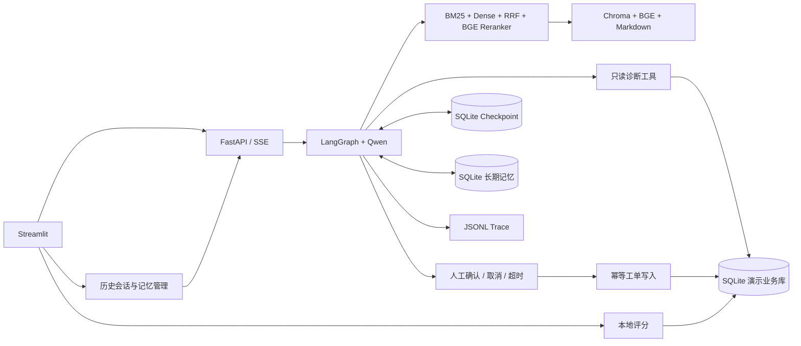

# SaaS 智能技术支持 Agent

面向虚构“星河协作平台”的本地演示项目：中文知识问答、应用配额与请求日志查询、导出条件诊断、人工确认后创建工单。沿用 LangGraph + Qwen + FastAPI + Streamlit，SaaS 业务数据与会话检查点使用 SQLite。

## 启动

在项目根目录配置 `.env` 的 `DASHSCOPE_API_KEY`、`DASHSCOPE_BASE_URL`、`DASHSCOPE_MODEL`，设置 `CUSTOMER_SUPPORT_MODE=qwen`。示例见 `.env.qwen.example`，不要提交真实密钥。

```powershell
# 本机运行
uv sync --frozen
powershell -ExecutionPolicy Bypass -File scripts/start_demo.ps1
# 或启动 Docker Desktop 后运行容器
 docker compose -f compose.saas.yaml up -d --build
```

打开 http://127.0.0.1:8501 ，API 为 http://127.0.0.1:8080 。端口冲突时设置 `SAAS_API_PORT` / `SAAS_UI_PORT` 再运行 Compose。首次知识检索会下载 BGE embedding 模型，需要网络；模型和索引缓存保存在命名卷中。

```powershell
docker compose -f compose.saas.yaml logs --tail 60 agent_service
docker compose -f compose.saas.yaml stop
docker compose -f compose.saas.yaml start
```

停止容器不会删除数据；不要对需要保留的数据卷使用 `down -v`。`SAAS_ONLY=1` 限制服务注册为 SaaS 入口，并要求会话请求携带记忆空间凭证；`customer-support` 是兼容别名。

## 架构



知识规则必须带文档来源；动态数据只来自业务工具。导出工具只诊断条件，不生成文件。工单写入先暂停等待确认，默认审批有效期 900 秒（`SAAS_APPROVAL_TTL_SECONDS`）；取消或超时不写入，恢复使用原会话 ID。数据库以租户和幂等键去重，相同键不同内容返回冲突。新的独立提交是新的工单请求。

Trace 位于 `data/logs/saas_trace.jsonl`（容器 `/app/runtime/saas_trace.jsonl`），包含会话 ID、意图、工具、耗时、状态、错误码和检索文档 ID；不记录工具参数或完整提示词。评分按运行 ID 存储到 SQLite，不依赖 LangSmith。模型最终工单成功声明需对应本轮工具返回编号，演示验证码会在最终文本中隐藏。SSE 输出完整校验后的答案，仍提供工具事件。

### 自动长期记忆与历史会话

Qwen 模式会在每轮主回答完成后，从**当前用户消息**中结构化提取稳定的环境、偏好、习惯和技术背景，并以 `add/update/delete/noop` 写入 SQLite。临时故障、动态配额、应用/请求/工单编号、日志、验证码、密码、Token 和 API Key 不会进入长期记忆；提取失败不会影响主回答。新会话会选择至多 8 条相关记忆注入模型上下文，当前消息与工具实时数据始终优先。Mock 模式不伪造自动提取，页面会明确提示未配置真实提取器。

Streamlit 侧栏提供新建、搜索、打开、继续、重命名和删除历史会话，并按今天/昨天/更早分组。消息正文和人工确认状态仍以 LangGraph SQLite Checkpoint 为事实来源；会话表只保存标题、归属和时间元数据。删除采用软删除，Checkpoint 暂不物理清理，但删除后 API、历史恢复和继续执行都不可访问。

本地演示以随机 capability token 作为记忆空间身份，保存到浏览器 Cookie/localStorage；链接不携带该凭证，不同身份不能读取彼此会话、记忆或 Trace。页面可导出/恢复凭证，以便清理浏览器数据或换浏览器后恢复。此机制适合本地单用户演示，不等同于生产登录：生产部署应接入正式账户、使用 Secure/HttpOnly Cookie、CSRF 防护与服务端租户授权。详细设计和验收步骤见 [长期记忆与历史会话](docs/saas-memory-conversations.md)。

## 当前检索链路

默认使用 **BM25＋BGE向量检索＋RRF（k=60）＋BAAI/bge-reranker-base**。先融合两路召回，过滤低相关证据，再对前15个候选交叉编码重排，返回前2条。模型实例在进程内复用，CPU并发访问串行化。模型不可用时明确报工具错误，不静默降级为Hybrid。首次使用需下载重排模型约1GB，CPU延迟会高于旧Hybrid。

## 演示与验收

1. 问“API 返回401怎么办？”：检查检索工具与文档引用。
2. 问“APP_DEMO_001 导出5001条失败，验证码 DEMO-ALPHA-4821”：应返回单次5000条限制。
3. 新会话仅问“为什么导出5001条失败”：逐步补应用和验证码，检查多轮参数保持。
4. 要求创建工单，给出应用、验证码、类别与故障摘要：确认前无写入；确认后返回真实编号，继续查询应为“待处理”。另开会话测试取消。
5. 草稿产生后重启 API，保持原会话再确认，验证检查点恢复。等待超过审批有效期应拒绝旧草稿并要求重新提交。
6. 用错误验证码查询配额：应拒绝，不返回其他应用数据。对答案评分后检查 SQLite feedback 表。
7. 告诉助手“我主要使用 Windows，以后优先给 PowerShell 命令”，等待回答完成；新建会话提问部署问题，检查回答和“长期记忆”面板。刷新页面后检查历史会话仍可打开和继续。

合成身份：`APP_DEMO_001 / DEMO-ALPHA-4821`（2.0 编辑者）；`APP_DEMO_002 / DEMO-BETA-7394`（1.0 访客）。这些是公开演示数据，不是生产认证系统。当前不提供真实外部工单通知、生产配额查询、多租户账户管理。会话检查点保存对话，本地部署仍需保护数据库；应用验证码不能替代正式身份鉴权。

## 复跑

```powershell
$env:PYTHONPATH='src'
uv run pytest tests/technical_support tests/service/test_service.py tests/service/test_auth.py -q
uv run python scripts/accept_saas_stage1.py
uv run python scripts/accept_saas_stage2.py --base-url http://127.0.0.1:8080
uv run python scripts/evaluate_saas_ablation.py
```

真实 Qwen 验收会产生模型调用费用。消融脚本会下载并运行 BGE reranker，CPU 运行较慢。实验与测试证据在 `data/evaluation/`，说明见 [阶段验收记录](docs/saas-acceptance.md) 和 [检索消融报告](docs/saas-retrieval.md)。原电商说明保留于 [历史 README](docs/legacy-ecommerce-readme.md)，原 `compose.yaml` 属于历史电商部署。
