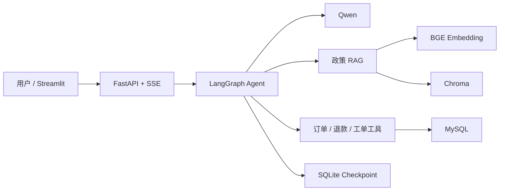

# 电商智能客服与工单协同 Agent

一个面向电商客服场景的 AI 应用工程项目，覆盖政策问答、订单查询、退款资格判断和
人工工单协同。项目基于 LangGraph、FastAPI、Qwen、Chroma 与 MySQL 构建，并重点
验证 RAG 效果、工具调用可靠性、写操作安全和容器化交付。

> 项目用于本地学习、测试和作品展示，未在真实生产环境上线，也不包含真实客户数据。

## 项目亮点

- 使用 LangGraph 和 Qwen Function Calling 编排政策检索、订单查询、退款判断、工单创建
  4 类工具，支持多轮对话、Checkpoint、Human-in-the-loop 确认与中断恢复。
- 构建覆盖 16 类电商政策的 BGE + Chroma 混合 RAG，融合词法检索和向量检索，并加入
  相关度拒答机制。
- 在 72 条分层评测用例上，hybrid Hit@1 为 93.75%、Hit@3 为 100%、MRR@3 为
  96.61%，8 条越界问题全部正确拒答，P95 检索延迟为 13.47 ms。
- 将 99,441 笔 Olist 匿名公开订单和 112,650 条订单明细迁移至 MySQL，使用外键、索引、
  批量写入与源文件 SHA-256 实现可重复、幂等的数据迁移。
- 对订单查询统一身份校验失败响应；工单写入同时使用 HITL 和幂等键，降低越权查询与
  重复写入风险。
- 使用 Docker Compose 编排 MySQL、一次性数据迁移、FastAPI、Streamlit 和只读数据库
  浏览器 5 个组件。

## 架构



## 评测结果

### RAG 检索

| 方法 | Hit@1 | Hit@3 | MRR@3 | 越界拒答率 | P95 延迟 |
| --- | ---: | ---: | ---: | ---: | ---: |
| lexical | 87.50% | 96.88% | 91.67% | 75.00% | 3.99 ms |
| dense | 87.50% | 100.00% | 93.49% | 100.00% | 13.09 ms |
| hybrid | **93.75%** | **100.00%** | **96.61%** | **100.00%** | 13.47 ms |

评测集包含 64 条相关问题和 8 条越界问题，详细结果见
[`data/evaluation/rag_report.json`](data/evaluation/rag_report.json)。这些指标来自项目构造的
固定评测集，只代表本项目实验结果，不能外推为线上业务准确率。

### Agent 业务验收

路由、退款规则、身份校验和工单幂等共 34 条确定性验收用例，当前为 34/34 通过。详细
结果见 [`data/evaluation/agent_report.json`](data/evaluation/agent_report.json)。

## 快速开始

Windows 用户可从 [`START_HERE.md`](START_HERE.md) 开始。默认使用离线 Mock Agent，
不需要模型 API Key：

```powershell
.\scripts\setup_demo.cmd
.\scripts\start_demo.cmd
```

浏览器访问 <http://127.0.0.1:8501>。

运行项目相关测试与评测：

```powershell
.\scripts\run_tests.cmd
.\scripts\evaluate_rag.cmd
.\.venv\Scripts\python.exe scripts\evaluate_agent.py
```

切换至真实 Qwen Agent 时，仅在本地 `.env` 中填写 Key。可复制
`.env.qwen.example`，不要将真实凭据提交到 Git。

## Docker + MySQL

完整部署需要 Docker Desktop。项目不会提交 Olist 原始数据或生成后的数据库，数据准备
方式见 [`docs/data/olist-dataset.md`](docs/data/olist-dataset.md)。

```powershell
.\scripts\start_docker.cmd
.\scripts\verify_docker.cmd
.\scripts\verify_qwen_docker.cmd
```

详细说明见 [`docs/deployment/docker-mysql.md`](docs/deployment/docker-mysql.md)。

## 主要目录

```text
src/customer_support/    RAG、业务规则、订单与工单数据访问
src/agents/              LangGraph 客服 Agent 与工具路由
src/service/             FastAPI、SSE、鉴权与就绪检查
scripts/                 数据迁移、评测和部署验收脚本
tests/customer_support/  客服场景单元测试
data/evaluation/         固定评测集与结果
data/policies/           示例政策知识库
docs/                    数据、部署和问题排查记录
```

## 安全与边界

- `.env`、数据库、原始数据、模型缓存、Chroma 数据和本地日志均被 Git 忽略。
- Olist 数据为匿名公开数据；演示手机号后四位由匿名 ID 确定性生成，不是真实手机号。
- API 支持 Bearer 鉴权，但本地 Compose 默认只绑定 `127.0.0.1`，未作为生产部署方案。
- 当前尚未完成独立标注集验证、并发压测、线上监控和灾难恢复演练。

## 上游项目与许可证

本项目基于 Joshua Carroll 的
[`JoshuaC215/agent-service-toolkit`](https://github.com/JoshuaC215/agent-service-toolkit)
进行业务化二次开发。原项目及本项目继续遵循仓库中的 MIT License，并保留原版权声明。
