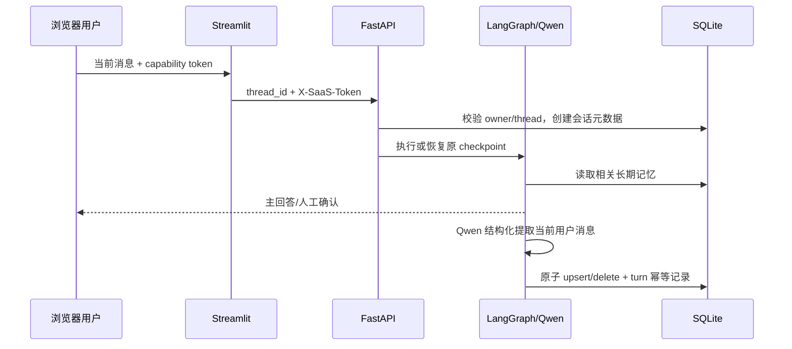

# 自动长期记忆与历史会话

## 实现范围

- Qwen 对每个已完成用户轮次执行结构化记忆提取，操作为 `add/update/delete/noop`。
- SQLite 持久化记忆、提取幂等记录、会话元数据、身份和线程归属；不引入 PostgreSQL、Redis 或 Mem0。
- 新会话按相关性和通用偏好选择最多 8 条、总计不超过 2400 字符的记忆。
- Streamlit 侧栏支持新建、搜索、打开、继续、重命名、软删除以及今天/昨天/更早分组。
- 原消息、工具调用、HITL 草稿和中断状态继续由 LangGraph SQLite Checkpoint 保存与恢复。

## 数据流



主回答不依赖记忆写入成功。模型提取超时、JSON 校验失败或服务异常时只写脱敏 Trace，回答照常返回。

## 表与边界

| 表 | 用途 | 关键约束 |
| --- | --- | --- |
| `support_profiles` | 随机身份摘要、自动记忆开关、旧偏好兼容 | token 只在客户端持有，服务端存 SHA-256 摘要 |
| `support_threads` | thread 到 owner 的不可变归属 | 其他 owner 不能认领 |
| `support_memories` | 长期事实 | `(owner, memory_key)` 唯一，更新采用 UPSERT |
| `support_memory_turns` | 防重试重复提取 | `(owner, thread_id, message_hash)` 唯一 |
| `support_conversations` | 标题、创建/更新时间、软删除 | 正文不重复存储 |

删除会话后仍保留底层 Checkpoint，便于审计和将来的保留策略；当前 API 会拒绝恢复、历史读取与继续执行。删除单条或全部长期记忆是物理删除。旧 `answer_style/environment_note` 偏好 API 保留并无损迁移到新记忆表。

## 安全与隐私

提取器只读取当前用户消息和既有记忆键值，不读取工具原始输出。服务端再次执行确定性过滤：动态错误码、配额、日志、应用/请求/工单 ID、验证码、密码、Token、API Key 和被 Trace 脱敏器识别的内容均拒绝保存。记忆仅作为用户提供的数据上下文，不能改变系统规则，也不能证明当前应用权限或动态业务状态。

本地页面使用一年期 SameSite=Strict Cookie，并以 localStorage 作为同浏览器恢复辅助；页面支持手工导出/恢复凭证。由于 JavaScript 需要读取该凭证，本地方案不是 HttpOnly。生产环境必须替换为正式认证、服务端 Session/HttpOnly Secure Cookie、CSRF 防护和组织级租户权限。

专用 Docker 部署设置 `SAAS_ONLY=1`：无凭证的 invoke、stream 和 history 请求会被拒绝；历史数据还要通过 owner 与 thread 的归属校验。旧版没有绑定 owner 的 Checkpoint 不会被任意新身份认领，需保留原数据并通过受信迁移流程处理。

## 自动化复跑

```powershell
$env:PYTHONPATH="$PWD;$PWD\src"
$env:CUSTOMER_SUPPORT_MODE="mock"
.\.venv\Scripts\python.exe -m pytest `
  tests/technical_support/test_memory_conversations.py `
  tests/technical_support tests/service/test_service.py tests/service/test_auth.py -q
.\.venv\Scripts\python.exe -m ruff check src tests/technical_support/test_memory_conversations.py
git diff --check
```

专项用例覆盖新增、重复、更新、明确删除、noop、敏感/动态内容过滤、提取异常、SQLite 重连、跨身份隔离、开关、记忆手工删除、会话搜索/重命名/软删除和越权访问。原有回归继续覆盖消息历史、Checkpoint 重启恢复、HITL 恢复与工单幂等。

## 浏览器验收

1. Qwen 模式打开页面，输入“我主要使用 Windows，以后请优先给 PowerShell 命令”。
2. 回答完成后展开“长期记忆”，应看到稳定环境/偏好；不应保存验证码或当前故障编号。
3. 点击“新建会话”，询问“Docker 怎么部署？”，检查回答使用已记住的环境偏好。
4. 刷新浏览器，确认侧栏仍有两个会话；打开旧会话并继续追问。
5. 重命名并搜索会话；删除后确认它从列表消失，原链接不能恢复。
6. 发起创建工单但停在人工确认，切到另一会话再切回，确认/取消按钮与草稿仍存在，且不会重复建单。
7. 关闭并重新启动容器（不要执行 `down -v`），重复第 2、4、6 步验证持久化。
